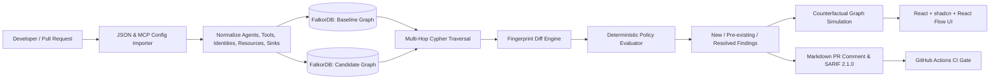

# GraphGate CI — Before/After AI-Agent Data-Flow Impact Simulator

> **Track:** Graph Hacks Track 01 — Agents That Act on Connected Data  
> **Prototype Goal:** A free, local-first proof-of-concept that compares two AI-agent configuration snapshots, models toolchains and identities in **FalkorDB**, enumerates newly reachable sensitive data flows with Cypher, enforces deterministic security policies, and explains why a pull request should **PASS**, **WARN**, or **FAIL** CI.

---

## 1. The Core Problem

When engineers integrate AI agents into repositories, documents, databases, customer communications, and external APIs, a minor configuration change—adding a connector, expanding an OAuth scope, swapping a service account, or adding a webhook—can create an **unintended transit path from sensitive internal records to external sinks**.

A traditional git diff shows lines added or removed, but **cannot explain what transitive data flows become reachable when multiple tools and identities compose**.

GraphGate CI analyzes declarative agent configurations *before merge*, builds before/after capability graphs in **FalkorDB**, discovers newly reachable paths from confidential/restricted data to untrusted destinations, presents concrete step-by-step witness paths, and provides a **counterfactual simulation** to test breaking the risky path.

---

## 2. Architecture & Data Flow



### Path Witness Sequence

A candidate PR might look innocent, but composes a critical exfiltration path:

```mermaid
flowchart LR
  Source[Resource: payroll.csv\nRESTRICTED] -->|CAN_READ| IdR[Identity: drive-read-id]
  IdR -->|AUTHENTICATES_AS| ReadTool[Tool: drive-reader]
  ReadTool -->|RETURNS_TO| Ctx[AgentContext: reporting-agent-ctx]
  Ctx -->|HAS_CONTEXT| Agent[Agent: reporting-agent]
  Agent -->|USES_TOOL| SendTool[Tool: webhook-sender]
  SendTool -->|AUTHENTICATES_AS| IdS[Identity: webhook-id]
  IdS -->|CAN_SEND_TO| Dest[Destination: external-webhook\nEXTERNAL]
  classDef risky fill:#fee2e2,stroke:#dc2626,color:#7f1d1d;
  class Source,Dest,Agent,ReadTool,SendTool risky;
```



---

## 3. FalkorDB Graph Schema

### Node Labels
- `Agent`: `id`, `name`, `framework`, `snapshot_id`
- `AgentContext`: `id`, `name`, `is_shared`, `snapshot_id` (explicit context/memory boundary)
- `Tool`: `id`, `name`, `kind` (`read`, `write`, `send`, `execute`), `snapshot_id`
- `Identity`: `id`, `name`, `principal_type` (`service_account`, `oauth_token`, `api_key`), `snapshot_id`
- `Resource`: `id`, `name`, `resource_type`, `classification`, `snapshot_id`
- `DataClass`: `id`, `level` (`public`, `internal`, `confidential`, `restricted`, `unknown`)
- `Destination`: `id`, `name`, `trust` (`internal`, `approved_external`, `external`, `untrusted`, `unknown`)
- `Policy`: `id`, `name`, `severity`, `description`

### Relationships
- `(Agent)-[:HAS_CONTEXT]->(AgentContext)`
- `(Agent)-[:USES_TOOL]->(Tool)`
- `(Tool)-[:RETURNS_TO]->(AgentContext)`
- `(Tool)-[:AUTHENTICATES_AS]->(Identity)`
- `(Identity)-[:CAN_READ]->(Resource)`
- `(Resource)-[:CLASSIFIED_AS]->(DataClass)`
- `(Identity)-[:CAN_SEND_TO]->(Destination)`

---

## 4. Key Cypher Query

Multi-hop transitive reachability query executed in FalkorDB:

```cypher
MATCH
  (src:Resource)<-[:CAN_READ]-(readIdentity:Identity)
    <-[:AUTHENTICATES_AS]-(readTool:Tool)
    -[:RETURNS_TO]->(ctx:AgentContext)
    <-[:HAS_CONTEXT]-(agent:Agent)
    -[:USES_TOOL]->(sendTool:Tool)
    -[:AUTHENTICATES_AS]->(sendIdentity:Identity)
    -[:CAN_SEND_TO]->(dst:Destination),
  (src)-[:CLASSIFIED_AS]->(class:DataClass)
WHERE (agent)-[:USES_TOOL]->(readTool)
RETURN DISTINCT
  agent.id AS agent_id,
  src.id AS source_id,
  class.level AS classification,
  readTool.id AS read_tool,
  readIdentity.id AS read_identity,
  ctx.id AS agent_context,
  sendTool.id AS send_tool,
  sendIdentity.id AS send_identity,
  dst.id AS destination_id,
  dst.trust AS destination_trust
LIMIT $limit
```

### Stable Fingerprint Diffing

Every path produces a stable hash string:
`agent_id | source_id | classification | read_tool | read_identity | send_tool | send_identity | destination_id | policy_id`

- `new = candidate_violations - baseline_violations`
- `pre_existing = baseline_violations ∩ candidate_violations`
- `resolved = baseline_violations - candidate_violations`
- `needs_review = unclassified or unknown scopes in candidate`

---

## 5. Deterministic Policy Rules

GraphGate CI **does not use an LLM to decide pass or fail**. CI decisions are strictly deterministic:

| Policy ID | Policy Name | Scope / Condition | Severity | Gate Decision |
|---|---|---|:---:|:---:|
| `POL-001` | Restricted Egress Prohibition | `classification == 'restricted'` AND `destination_trust IN ['external', 'untrusted']` | **CRITICAL** | **FAIL (Merge Blocked)** |
| `POL-002` | Confidential Egress Guardrail | `classification == 'confidential'` AND `destination_trust IN ['external', 'untrusted']` | **HIGH** | **FAIL (Merge Blocked)** |
| `POL-003` | Unknown Boundary Audit | `classification == 'unknown'` OR `destination_trust == 'unknown'` | **MEDIUM** | **WARN (Needs Review)** |
| `POL-004` | External Egress Notice | `classification IN ['public', 'internal']` AND destination is external | **INFO** | **PASS (Logged)** |
| `POL-005` | Compliant Internal Flow | Destination is `internal` or `approved_external` | **INFO** | **PASS (Approved)** |

---

## 6. Counterfactual Remediation

When a new critical path is discovered, GraphGate CI computes the candidate edges on the witness path:
1. Revoke the read scope: `(readIdentity)-[:CAN_READ]->(Resource)`
2. Unlink the agent outbound tool: `(Agent)-[:USES_TOOL]->(SendTool)`
3. Narrow the destination egress: `(SendIdentity)-[:CAN_SEND_TO]->(Destination)`

The user can click **"Simulate Fix"**: GraphGate clones the candidate into an isolated temporary graph in FalkorDB, severs the selected relationship, reruns the Cypher query, and confirms whether the target violation disappears without breaking legitimate workflows.

---

## 7. Differentiation & Market Positioning

| Tool | Overlap | GraphGate CI Proposed Differentiation |
|---|---|---|
| **AgentCapDiff** | Static capability diffs, rules, PR reports | GraphGate models explicit multi-hop data flow (source classification $\to$ identity $\to$ tool $\to$ context $\to$ agent $\to$ tool $\to$ sink trust), before/after graph diffs, and an executable counterfactual simulation in FalkorDB. |
| **Agent Permission Diff Bot** | Semantic permission changes in PRs | Treats the graph as an executable reachability model; distinguishes newly reachable data flows from raw permission line changes. |
| **MCP-XRay** | MCP permission extraction and graph viz | Focuses on CI gating, deterministic policies, step-by-step witness evidence, and counterfactual fixes. |
| **MCP-Scan** | Tool description injection checks, runtime proxying | Complementary; GraphGate focuses on transitive configuration risk, not runtime prompt injection or proxying. |
| **Promptfoo** | LLM red-teaming and behavioral evaluation | Complementary; Promptfoo evaluates behavioral failure modes; GraphGate provides pre-deployment topological graph constraints. |

> **Caveat:** GraphGate detects *structurally reachable flows* permitted by declarative configuration. It does not prove that exfiltration actually occurred at runtime.

---

## 8. Quickstart & Local Setup

### Prerequisites
- Docker & Docker Compose
- Python 3.11+
- Node.js 18+

### 1. (Optional) Start FalkorDB Container
If Docker Desktop is running on your machine:
```bash
docker compose up -d
```
FalkorDB will be accessible at `localhost:6379`, and FalkorDB Browser at `http://localhost:3000`.

> **💡 Zero-Docker Fallback:** If Docker Desktop is not started or unavailable, GraphGate CI automatically and seamlessly activates its embedded high-fidelity graph engine. It executes the exact same Cypher multi-hop traversals and deterministic policies locally with zero dependencies!

### 2. Run the Backend & Dashboard
```powershell
cd C:\PROJECTS\graphgate-ci\backend
.\.venv\Scripts\Activate.ps1

# Option A: Simplest (one command)
python run.py

# Option B: Via uvicorn directly
python -m uvicorn backend.app.main:app --reload --port 8000
```
Open **`http://127.0.0.1:8000`** in your browser to view the interactive dashboard.

### 3. (Optional) Run Frontend Dev Server with Hot-Reload
The production frontend bundle is already pre-compiled into `frontend/dist` and served directly by FastAPI. If you wish to run the Vite hot-reloading dev server:
```powershell
cd C:\PROJECTS\graphgate-ci\frontend
npm run dev
```
Open `http://localhost:5173` in your browser.

---

## 9. 2-Minute Demo Script

1. **Load Dashboard**: Notice the default seeded scenario (**Risky PR: Add HR Payroll Reader + External Webhook**).
2. **Observe CI Gate**: The top banner immediately displays **`FAIL (Blocked)`** with **1 New Violation**.
3. **Inspect Interactive Graph**: In the Graph Explorer canvas, the multi-hop path `payroll.csv` $\to$ `drive-read-id` $\to$ `drive-reader` $\to$ `ctx` $\to$ `reporting-agent` $\to$ `webhook-sender` $\to$ `external-webhook` is highlighted in **pulsing red**.
4. **Inspect Finding Witness**: In the Findings Table, click **"Witness"** to open the drawer. Review the step-by-step numbered traversal log explaining how the permission composition enables the flow.
5. **Run Counterfactual Simulation**:
   - Click **"Simulate Fix"**.
   - Select the candidate edge: `Revoke read access on payroll.csv from drive-read-id`.
   - Click **"Run Counterfactual Simulation"**.
   - Observe the result: Violations drop from **1 to 0**, confirming the path is severed!
6. **Switch Scenarios**: In the top navigation bar, switch to **Safe PR** to see a clean **`PASS`** with zero new violations.
7. **Inspect CI & SARIF Export**: Switch to the **CI Report & SARIF** tab to preview the markdown PR comment and download the SARIF 2.1.0 file for GitHub Code Scanning.

---

## 10. Open-Source & Free Tool Stack Notices

- **FalkorDB**: Server image is SSPLv1 (source-available, free for local/hackathon usage). Python client is MIT-licensed.
- **FastAPI / Pydantic**: MIT License.
- **React / Vite / TypeScript / Tailwind CSS**: MIT License.
- **@xyflow/react (React Flow)**: MIT License.
- **Lucide React**: ISC License.
